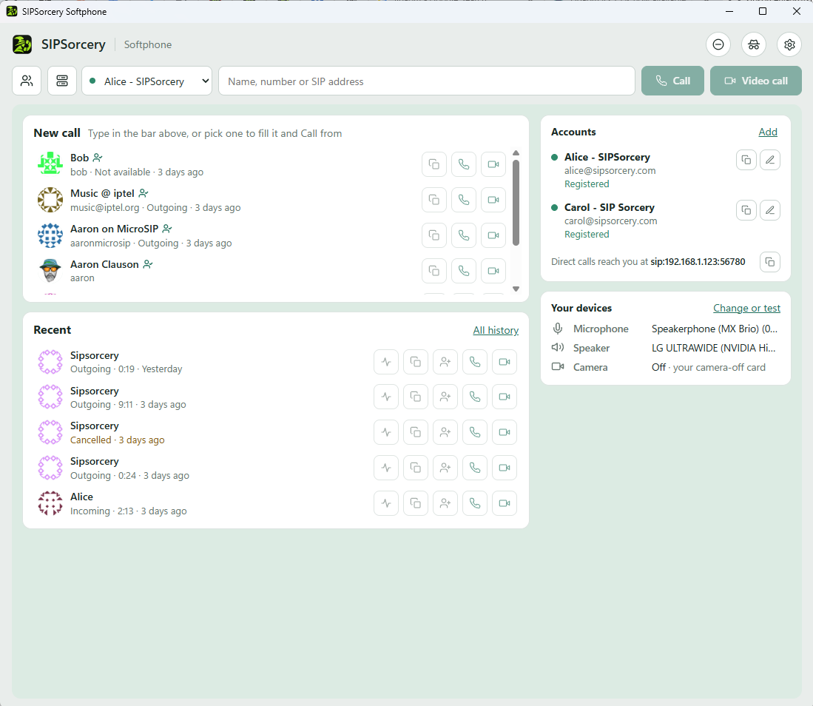
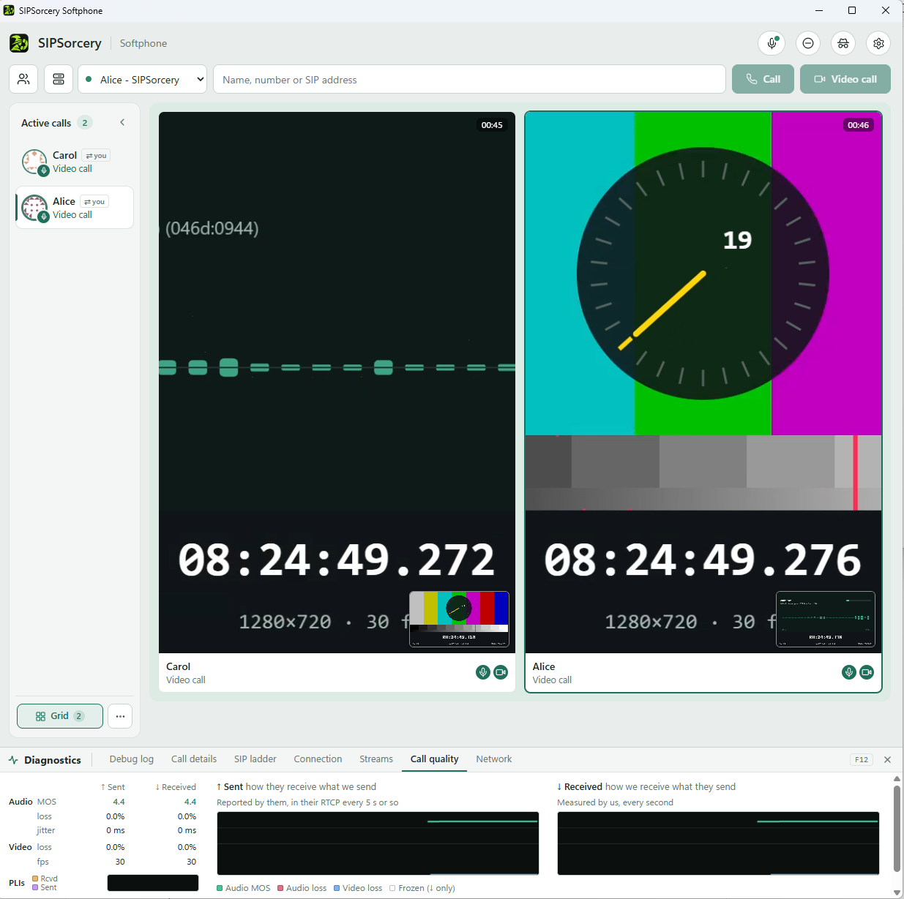
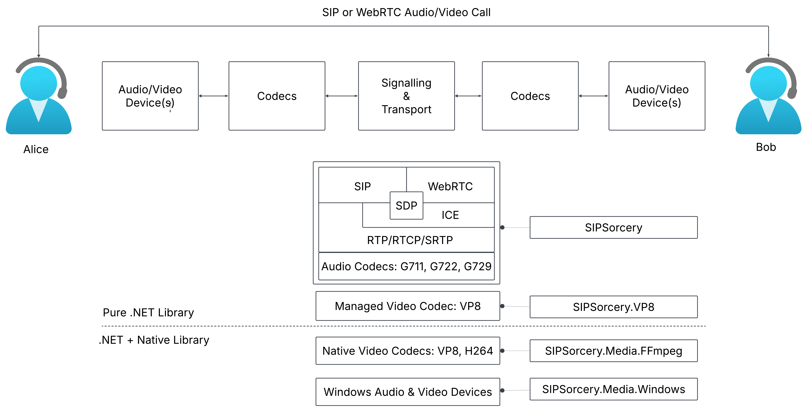

 
 
 
 

## License

 

**BSD 3-Clause License with an explicit prohibition on use by entities contributing to Israeli occupation or genocide.**

For full license see [LICENSE](https://github.com/sipsorcery-org/sipsorcery?tab=License-1-ov-file).

**The SIPSorceryMediaFFmpeg library is licensed separately under GNU LGPL v2.1 see [License](https://github.com/sipsorcery-org/sipsorcery/tree/master/src/SIPSorceryMedia.FFmpeg/LICENSE)**
 
## SIPSorcery Repository Overview

This repository is the home of the **SIPSorcery** project - a comprehensive real-time communications library for .NET that enables developers to add VoIP and WebRTC capabilities to their applications. The project consists of multiple packages and extensive examples to help you get started quickly.

### Core Packages

| Package | Version | Downloads | Description | README |
|---------|---------|-----------|-------------|---------|
| **SIPSorcery** | [](https://www.nuget.org/packages/SIPSorcery) | [](https://www.nuget.org/packages/SIPSorcery) | Core library with SIP, WebRTC, RTP, ICE, STUN, and SDP support | [README](src/SIPSorcery/README.md) |
| **SIPSorceryMedia.Abstractions** | [](https://www.nuget.org/packages/SIPSorceryMedia.Abstractions) | [](https://www.nuget.org/packages/SIPSorceryMedia.Abstractions) | Interfaces for audio/video encoders and device access | [README](src/SIPSorceryMedia.Abstractions/README.md) |
| **SIPSorceryMedia.Windows** | [](https://www.nuget.org/packages/SIPSorceryMedia.Windows) | [](https://www.nuget.org/packages/SIPSorceryMedia.Windows) | Windows-specific audio capture and playback and video capture | [README](src/SIPSorceryMedia.Windows/README.md) |
| **SIPSorceryMedia.FFmpeg** | [](https://www.nuget.org/packages/SIPSorceryMedia.FFmpeg) | [](https://www.nuget.org/packages/SIPSorceryMedia.FFmpeg) | Cross-platform media support using FFmpeg | [README](src/SIPSorceryMedia.FFmpeg/README.md) |

### Video Codec Ports

The packages below are ongoing attempts to port a number of C based video codecs. While none of the efforts are yet deemded production ready the idea is that they will eventually make the reliance on FFmpeg optional.

Some performance mesaurements of the various codecs can be found [below](#video-pipeline-capacity).

| Package | Version | Downloads | Description | README |
|---------|---------|-----------|-------------|---------|
| **SIPSorcery.VP8** | [](https://www.nuget.org/packages/SIPSorcery.VP8) | [](https://www.nuget.org/packages/SIPSorcery.VP8) | C# port of VP8 codec from [libvpx](https://chromium.googlesource.com/webm/libvpx) | [README](src/SIPSorcery.VP8/README.md) |
| **SIPSorcery.AV1** |  |  | C# port of AV1 encoder from [libaom](https://aomedia.org/blog%20posts/Libaom-v3_15-is-now-available/) - thanks to [@lostmsu](https://github.com/lostmsu) | [README](src/SIPSorcery.AV1/README.md) |

### Demo Softphone

A fully featured Windows and Web softphone application ([README](examples/Softphonev2/desktop/README.md)). Web version available for GitHub users to experiment with [here](https://www.sipsorcery.com/softphone/).

<p>
  
  
</p>

### Examples

This repository includes **[70+ example projects](examples/)** demonstrating various SIP and WebRTC scenarios:

- **[SIP Examples](examples/SIPExamples/)** - Basic calling, transfers, DTMF, registration, and more ([README](examples/SIPExamples/README.md))
- **[WebRTC Examples](examples/WebRTCExamples/)** - Video streaming, data channels, signaling patterns ([README](examples/WebRTCExamples/README.md))
- **[SIP Scenarios](examples/SIPScenarios/)** - Call transfers, load testing, complex call flows ([README](examples/SIPScenarios/README.md))
- **[WebRTC Scenarios](examples/WebRTCScenarios/)** - Advanced WebRTC use cases ([README](examples/WebRTCScenarios/README.md))
- **[Softphone](examples/Softphone)** - Original WPF based softphone ([README](examples/Softphone/README.md))
- **[OpenAI](examples/OpenAIExamples/)** - Example applications for interacting with OpenAI's Realtime WebRTC and SIP end points ([README](examples/OpenAIExamples/GetStarted/README.md))

---

## What Is It?

**This fully C# library can be used to add Real-time Communications, typically audio and video calls, to .NET applications.**

The diagram below is a high level overview of a Real-time audio and video call between Alice and Bob. It illustrates where the `SIPSorcery` and associated libraries can help.



**Supports both VoIP ([get started](#getting-started-voip)) and WebRTC ([get started](#getting-started-webrtc)).**

**Some of the protocols supported:**

 - Session Initiation Protocol [(SIP)](https://tools.ietf.org/html/rfc3261),
 - Real-time Transport Protocol [(RTP)](https://tools.ietf.org/html/rfc3550),
 - Web Real-time Communications [(WebRTC)](https://www.w3.org/TR/webrtc/), **as of 26 Jan 2021 now an official IETF and W3C specification**,
 - Interactive Connectivity Establishment [(ICE)](https://tools.ietf.org/html/rfc8445),
 - SCTP, SDP, STUN and more.

**Media End Points - Audio/Video Sinks and Sources:**

 - The main `SIPSorcery` library does not provide access to audio and video devices or native codecs. Two separate library packages can be used depending on the runtime target:
   - [SIPSorceryMedia.Windows](src/SIPSorceryMedia.Windows): A Windows specific library that provides audio capture and playback. 
   - [SIPSorceryMedia.FFmpeg](src/SIPSorceryMedia.FFmpeg/): A cross platform library that can be used for high performance video codecs using PInvoke and [FFmpeg](https://ffmpeg.org/).

 - This library includes audio codecs G711, G722, G729 and, thanks to [Concentus](https://github.com/lostromb/concentus), OPUS.
 - A C# port of the VP8 video codec is available at [SIPSorcery.VP8 directory](src/SIPSorcery.VP8/) but it should be considered experimental and performs poorly at 1080p and greater. The advantage of the VP8 .NET port is it allows video streaming with NO native dependencies required.
 - High performance native video codecs (VP8, VP9, H264, H265 and AV1) are available via the [SIPSorcery FFmpeg](src/SIPSorceryMedia.FFmpeg/) package which in turn depends on [FFmpeg](https://ffmpeg.org/) being available at runtime. These video codecs (H264 is the fastest) can be used to stream 4k video at 30fps on a typical Windows machine. See [Video Pipeline Capacity](#video-pipeline-capacity) below for some benchmarking results.

## Installation

The library should work with .NET Framework >= 4.6.1 and all .NET Core and .NET versions. The demo applications initially targetted .NET Core 3.1 and are updated to later .NET versions as time and interest permit. The library is available via NuGet.

````bash
dotnet add package SIPSorcery
````

With Visual Studio Package Manager Console (or search for [SIPSorcery on NuGet](https://www.nuget.org/packages/SIPSorcery/)):

````ps1
Install-Package SIPSorcery
````

**FFmpeg Install**

See [SIPSorcery FFmpeg readme](src/SIPSorceryMedia.FFmpeg/README.md).

For Windows the easiest option is:

````ps1
winget install "FFmpeg (Shared)" --version 8.1
````

## Documentation

Class reference documentation and articles explaining common usage are available at [https://sipsorcery-org.github.io/sipsorcery/](https://sipsorcery-org.github.io/sipsorcery/).

## Getting Started VoIP

The simplest possible example to place an audio-only SIP call is shown below. This example relies on the Windows specific `SIPSorceryMedia.Windows` library to play the received audio and only works on Windows (due to lack of .NET audio device support on non-Windows platforms).

````bash
dotnet new console --name SIPGetStarted --framework net10.0 --target-framework-override net10.0-windows10.0.17763.0
cd SIPGetStarted
dotnet add package SIPSorcery
dotnet add package SIPSorceryMedia.Windows
# Paste the code below into Program.cs.
dotnet run
# If successful you will hear a "Hello World" announcement.
````

````csharp
string DESTINATION = "music@iptel.org";
        
Console.WriteLine("SIP Get Started");

var userAgent = new SIPSorcery.SIP.App.SIPUserAgent();
var winAudio = new SIPSorceryMedia.Windows.WindowsAudioEndPoint(new SIPSorcery.Media.AudioEncoder());
var voipMediaSession = new SIPSorcery.Media.VoIPMediaSession(winAudio.ToMediaEndPoints());

// Place the call and wait for the result.
bool callResult = await userAgent.Call(DESTINATION, null, null, voipMediaSession);
Console.WriteLine($"Call result {(callResult ? "success" : "failure")}.");

Console.WriteLine("Press any key to hangup and exit.");
Console.ReadLine();
````

The [GetStarted](https://github.com/sipsorcery-org/sipsorcery/tree/master/examples/SIPExamples/GetStarted) example contains the full source and project file for the example above.

The three key classes in the above example are described in dedicated articles:

 - [SIPTransport](https://sipsorcery-org.github.io/sipsorcery/articles/transport.html),
 - [SIPUserAgent](https://sipsorcery-org.github.io/sipsorcery/articles/sipuseragent.html),
 - [RTPSession](https://sipsorcery-org.github.io/sipsorcery/articles/rtpsession.html).

The [examples folder](https://github.com/sipsorcery-org/sipsorcery/tree/master/examples/SIPExamples) contains sample code to demonstrate other common SIP/VoIP cases.

## Getting Started WebRTC

The WebRTC specifications do not include directions about how signaling should be done (for VoIP the signaling protocol is SIP; WebRTC has no equivalent). The example below uses a simple JSON message exchange over web sockets for signaling. Part of the reason the `Getting Started WebRTC` is longer than the `Getting Started VoIP` example is the need for custom signaling.

The example requires two steps:

 - Run the `dotnet` console application,
 - Open an HTML page in a browser on the same machine.

 The full project file and code are available at [WebRTC Get Started](https://github.com/sipsorcery-org/sipsorcery/tree/master/examples/WebRTCExamples/WebRTCGetStarted).


**Step 1:**

````bash
dotnet new console --name WebRTCGetStarted
cd WebRTCGetStarted
dotnet add package SIPSorcery
dotnet add package SIPSorcery.VP8
# Paste the code below into Program.cs.
dotnet run
````

````csharp
using System;
using System.Linq;
using System.Net;
using System.Threading.Tasks;
using SIPSorcery.Media;
using SIPSorcery.Net;
using Vpx.Net;
using WebSocketSharp.Server;

namespace demo
{
    class Program
    {
        private const int WEBSOCKET_PORT = 8081;

        static void Main()
        {
            Console.WriteLine("WebRTC Get Started");

            // Start web socket.
            Console.WriteLine("Starting web socket server...");
            var webSocketServer = new WebSocketServer(IPAddress.Any, WEBSOCKET_PORT);
            webSocketServer.AddWebSocketService<WebRTCWebSocketPeer>("/", (peer) => peer.CreatePeerConnection = () => CreatePeerConnection());
            webSocketServer.Start();

            Console.WriteLine($"Waiting for web socket connections on {webSocketServer.Address}:{webSocketServer.Port}...");
            
            Console.WriteLine("Press any key exit.");
            Console.ReadLine();
        }

        private static Task<RTCPeerConnection> CreatePeerConnection()
        {
            var pc = new RTCPeerConnection(null);

            var testPatternSource = new VideoTestPatternSource(new VP8Codec());

            MediaStreamTrack videoTrack = new MediaStreamTrack(testPatternSource.GetVideoSourceFormats(), MediaStreamStatusEnum.SendOnly);
            pc.addTrack(videoTrack);

            testPatternSource.OnVideoSourceEncodedSample += pc.SendVideo;
            pc.OnVideoFormatsNegotiated += (formats) => testPatternSource.SetVideoSourceFormat(formats.First());

            pc.onconnectionstatechange += async (state) =>
            {
                Console.WriteLine($"Peer connection state change to {state}.");

                switch(state)
                {
                    case RTCPeerConnectionState.connected:
                        await testPatternSource.StartVideo();
                        break;
                    case RTCPeerConnectionState.failed:
                        pc.Close("ice disconnection");
                        break;
                    case RTCPeerConnectionState.closed:
                        await testPatternSource.CloseVideo();
                        testPatternSource.Dispose();
                        break;
                }
            };

            return Task.FromResult(pc);
        }
    }
}
````

**Step 2:**

Create an HTML file, paste the contents below into it, open it in a browser that supports WebRTC and finally press the `start` button.

````html
<!DOCTYPE html>
<head>
    <script type="text/javascript">
        const WEBSOCKET_URL = "ws://127.0.0.1:8081/"

        var pc, ws;

        async function start() {
            pc = new RTCPeerConnection();

            pc.ontrack = evt => document.querySelector('#videoCtl').srcObject = evt.streams[0];
            pc.onicecandidate = evt => evt.candidate && ws.send(JSON.stringify(evt.candidate));

            ws = new WebSocket(document.querySelector('#websockurl').value, []);
            ws.onmessage = async function (evt) {
                var obj = JSON.parse(evt.data);
                if (obj?.candidate) {
                    pc.addIceCandidate(obj);
                }
                else if (obj?.sdp) {
                    await pc.setRemoteDescription(new RTCSessionDescription(obj));
                    pc.createAnswer()
                        .then((answer) => pc.setLocalDescription(answer))
                        .then(() => ws.send(JSON.stringify(pc.localDescription)));
                }
            };
        };

        async function closePeer() {
            await pc?.close();
            await ws?.close();
        };

    </script>
</head>
<body>

    <video controls autoplay="autoplay" id="videoCtl" width="640" height="480"></video>

    <div>
        <input type="text" id="websockurl" size="40" />
        <button type="button" class="btn btn-success" onclick="start();">Start</button>
        <button type="button" class="btn btn-success" onclick="closePeer();">Close</button>
    </div>

</body>

<script>
    document.querySelector('#websockurl').value = WEBSOCKET_URL;
</script>
````

**Result:**

If successful the browser should display a test pattern image.

The [examples folder](https://github.com/sipsorcery-org/sipsorcery/tree/master/examples/WebRTCExamples) contains sample code to demonstrate other common WebRTC cases.

## Video Pipeline Capacity

Video processing — and encoding in particular — is generally the bottleneck in most real-time communications libraries. The original goal of the SIPSorcery library was to support 1080p video at 30 frames per second.

In June 2026, the SIPSorcery command line tool (`dotnet tool install -g SIPSorcery.Cli`, the `sipsorcery` command) was conceived to test various SIP, ICE, WebRTC, and benchmarking scenarios. The benchmarking has revealed that, thanks to the capabilities of the [FFmpeg](https://ffmpeg.org/) project (and the various libraries it in turn wraps), the SIPSorcery library running on a typical Windows machine with the H264 video codec is capable of processing 4K video at over 30fps and 1080p at over 100fps.

Sample test results are shown below. They were generated with [`run-video-bench.ps1`](src/SIPSorcery.Cli/benchmarks/run-video-bench.ps1), which drives two CLI commands (see the [benchmarks README](src/SIPSorcery.Cli/benchmarks/README.md) for the details):

- `sipsorcery webrtc video-bench` times one encoder or decoder alone, in-process, as fast as it will go. It gives the encode and decode tables: each figure is the maximum rate of that component on its own, so they are not achievable together in one call.
- `sipsorcery webrtc loopback` runs a real WebRTC session in one process. It gives the WebRTC pipeline table: the transport ceiling with no codec, and the maximum rate an app can send at (encode), receive at (decode), or do both in a full call.

### Machine

| CPU | Cores | Logical processors | Memory |
| --- | --- | --- | --- |
| Intel(R) Core(TM) i9-10900 CPU @ 2.80GHz | 10 | 20 | 31.8 GB |

### Results

_All measurements are maximum frames per second (FPS). For real-time communications a frame rate of 30 FPS is suitable._

**Encode** (the encoder alone):

| Preset | vp8.net | av1.net | ffmpeg H264 | ffmpeg VP8 | ffmpeg VP9 | ffmpeg H265 | ffmpeg AV1 |
|---|---|---|---|---|---|---|---|
| 480p | 83.9 | 151.5 | 973.4 | 369.9 | 192.1 | 212.8 | 147.3 |
| 720p | 29.6 | 57.1 | 365.9 | 129.3 | 98.6 | 92.2 | 65 |
| 1080p | 12.6 | 34.5 | 191.4 | 56.4 | 51.8 | 49.3 | 30 |
| 1440p | 6.9 | 20.7 | 109.3 | 41.2 | 32.3 | 31.2 | 16.4 |
| 4k | 2.8 | 7.7 | 47.4 | 35.6 | 17.2 | 14.6 | 8.3 |

**Decode** (the decoder alone, on a pre-encoded clip):

| Preset | H264 (ffmpeg) | VP8 (ffmpeg) | VP9 (ffmpeg) | H265 (ffmpeg) | AV1 (ffmpeg) | VP8 (vp8.net) |
|---|---|---|---|---|---|---|
| 480p | 2209.1 | 948.1 | 844.3 | 1094.5 | 577.4 | 167.9 |
| 720p | 861.2 | 301 | 391.8 | 435.3 | 208.8 | 58.2 |
| 1080p | 389.4 | 136.8 | 200.7 | 241.5 | 213.5 | 25.7 |
| 1440p | 221.2 | 74.2 | 119.9 | 155.5 | 118.4 | 14.5 |
| 4k | 99.7 | 33.6 | 54.8 | 76.5 | 72.7 | 6.6 |

**WebRTC pipeline** (H264 with the ffmpeg encoder and decoder, over a real WebRTC session in one process):

| Preset | Transport (no codec) | Send (encode) | Receive (decode) | Full call (encode + decode) |
|---|---|---|---|---|
| 480p | 7177.7 | 944.4 | 949 | 885 |
| 720p | 2539.4 | 318.4 | 680 | 298 |
| 1080p | 1456.8 | 172.5 | 307 | 150 |
| 1440p | 827.9 | 90.7 | 182 | 87 |
| 4k | 485.3 | 46.2 | 91 | 41 |

Transport sends pre-encoded frames flat out with no codec. Send encodes live and the receiver discards the frames, the case for an app that only sends. Receive decodes a pre-encoded stream, the case for an app that only receives. Full call does both. Receive and full call are the highest rates (to within 5%) at which no more than 2% of frames are lost or fail to decode. Both ends run on the one machine, so a one-way figure also carries the other end's (small) transport cost.

_Generated 2026-11-22 11:29; duration 6s/run, 1 run(s)/point._
